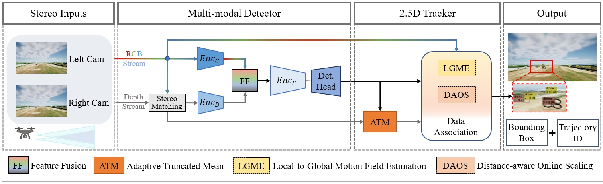
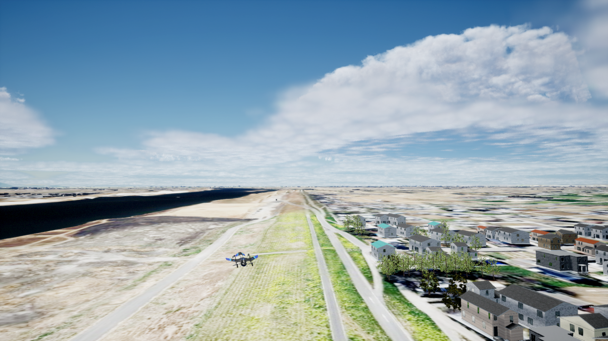
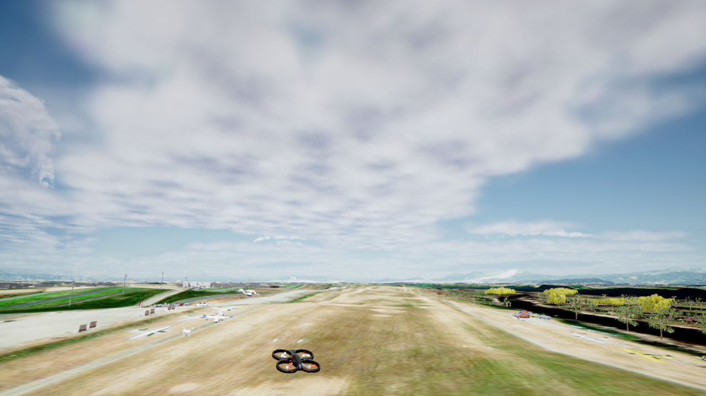
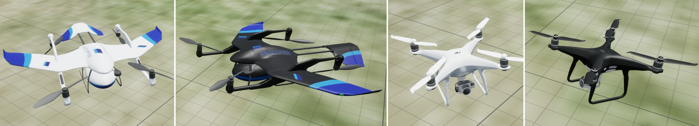
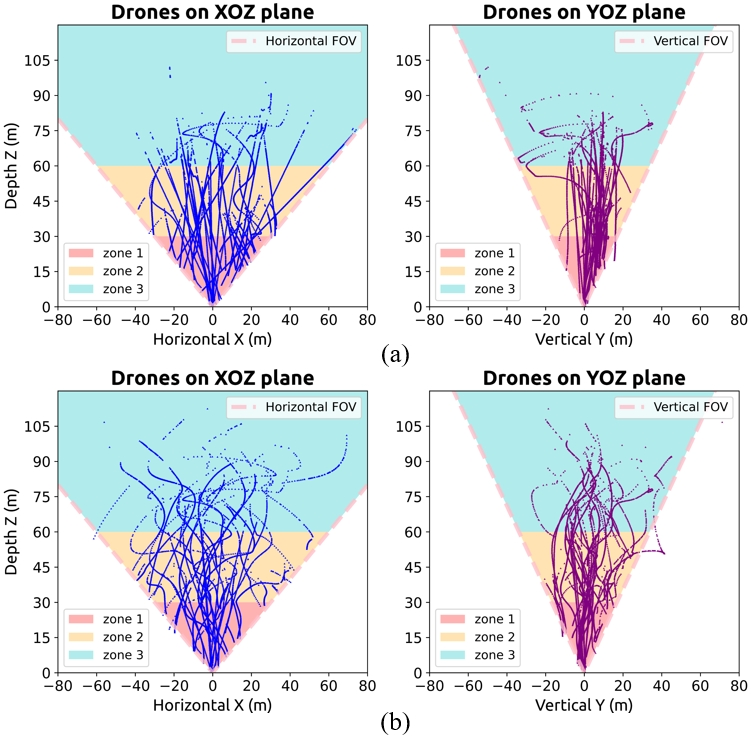

## StereoTracking
This repository is an implementation of the StereoTracking presented in the paper "Depth-Guided Multi-Object Tracking for Small Airborne Objects Using Stereo Vision"

Our code is based on the [mmTracking](https://github.com/open-mmlab/mmtracking/tree/1.x).

## Introduction
Safe UAV encounters require not only detecting nearby airborne objects but also maintaining their identities under severe scale variation, uncertain target motion, and strong ego-motion. Depth cues provide explicit geometric information about target distance, yet they have rarely been systematically integrated into both object detection and identity association for airborne multi-object tracking. We propose StereoTracking, a depth-guided framework for tracking small airborne objects, with calibrated stereo vision serving as the primary means of depth acquisition.

<div align="center">

</div>

## Getting Started
- [Installation](#installation)
- [AirDrone Dataset](#airdrone-dataset)
- [Testing](#testing)
- [Training](#training)
- [Export to ONNX](#export-to-onnx)
- [Demo on `Drone-vs-Bird` dataset](#demo-on-drone-vs-bird-dataset)

## Installation
```shell
conda create -n stereoTracking python=3.9.0 pip=22.2.2
conda activate stereoTracking
# Install pytorch
conda install pytorch==1.13.1 torchvision==0.14.1 torchaudio==0.13.1 pytorch-cuda=11.7 -c pytorch -c nvidia
# Install MMEngine, MMCV, MMDet, MMYOLO. Be aware that this must be done _after_ installing PyTorch, otherwise openmim will skip the installation of some components.
pip install -U openmim
mim install "mmengine==0.10.3" "mmcls==1.0.0rc4" "mmcv==2.0.0rc3" "mmdet==3.0.0rc4" "mmyolo==0.2.0" --trusted-host download.openmmlab.com
# Clone the repository
git clone https://github.com/Superjie13/StereoTracking.git
cd StereoTracking
# Install build requirements and build StereoTracking
  pip install -r requirements/build.txt
  pip install -v -e .  # or "python setup.py develop"
# For MOT Evaluation
pip install git+https://github.com/JonathonLuiten/TrackEval.git
```
### Environment
- Ubuntu 20.04
- Python 3.9
- PyTorch 1.13.1
- GPU RTX 4090 (24G)

## AirDrone Dataset
<div align="center">
<p float="left">
  
  
</p>
</div>

<div align="center">

</div>

Please download our dataset from the link below ([all files](https://www.dropbox.com/scl/fo/cr05dzx92gypix5llssxs/AJ7sgbbKq5YH2nDXjm-d4vU?rlkey=nalxfw8hdo8kgjr0hhtq2ztzv&dl=0)), unzip the left/right nested zips, and and build a soft link to the data folder.
- Sample of 1 sequence: [download (1.6 GB)](https://www.dropbox.com/scl/fo/cr05dzx92gypix5llssxs/AJ7sgbbKq5YH2nDXjm-d4vU?dl=0&e=1&preview=airdrone_sample.zip&rlkey=nalxfw8hdo8kgjr0hhtq2ztzv)
- Video previews of all sequences: [download (330 MB)](https://www.dropbox.com/scl/fo/cr05dzx92gypix5llssxs/ANlwRPaoSLBzBnN7ueG2IGs/airdrone_previews.zip?rlkey=nalxfw8hdo8kgjr0hhtq2ztzv&e=1&dl=0)
- Full dataset, 64 sequences: [download (141 GB, 15 files)](https://www.dropbox.com/scl/fo/cr05dzx92gypix5llssxs/AJ2EEUWKVjV7ukKI-AYvtiY/airdrone_full?dl=0&rlkey=nalxfw8hdo8kgjr0hhtq2ztzv&subfolder_nav_tracking=1)
  - To unzip, place all folders in the same dir, then run `zip -FF airdrone_full.zip --out airdrone_full_all.zip; unzip -FF airdrone_full_all.zip`. This will create a 141 GB contiguous file, and then unzip it, requiring 425 GB of space. Alternatively, use 7-Zip to avoid generating the contiguous copy of the zip.

### Annotation
Annotation format is similar to MOT-Challenge: 
`frame_id, id, x, y, w, h, confidence, X, Y, Z, class`
  - frame_id: frame number
  - id: object id
  - x, y, w, h: bounding box coordinates
  - confidence: detection confidence
  - X, Y, Z: 3D location of the object
  - class: object class

We provide the coco-style annotation in the `annotations` folder for simple usage.
```shell
mkdir data
ln -s /path/to/your/dataset data/
```

### Data Structure
```
data
├── AirDrone
│   ├── annotations
│   |  ├── train_cocoformat_[xx].json
│   |  ├── val_cocoformat_[xx].json
│   |  |── ...
│   ├── train
|   |  ├── video_sequence
|   |  |  ├── depth
|   |  |  ├── disparity
|   |  |  ├── left
|   |  |  ├── right
|   |  |  ├── ...
│   |  |── ...
│   ├── val
|   |  ├── video_sequence
|   |  |  ├── depth
|   |  |  ├── disparity
|   |  |  ├── left
|   |  |  ├── right
|   |  |  ├── ...
```

### Data Split
We split the dataset into training and validation sets.
#### Training Set (19 sequences)
```
0000, 0001,
2023-03-02-18-56-46, 2023-03-02-19-11-46,
2023-03-02-19-24-22, 2023-03-02-19-30-16,
2023-03-02-20-00-03, 2023-03-02-20-03-07,
2023-03-02-22-44-04, 2023-03-02-22-50-34,
2023-03-09-16-11-04, 2023-03-09-16-48-10,
2023-03-09-16-53-25, 2023-03-09-16-59-12,
2023-03-09-17-05-47, 2023-03-09-17-11-11,
2023-03-09-17-16-28, 2023-03-23-16-32-10,
and 2023-03-23-17-08-02.
```
#### Validation Set (45 sequences)
```
2023-03-02-18-16-23, 2023-03-02-19-15-09,
2023-03-02-19-27-33, 2023-03-02-19-33-05,
2023-03-02-19-36-01, 2023-03-02-22-38-01,
2023-03-20-15-32-49, 2023-03-20-15-40-43,
2023-03-20-15-59-35, 2023-03-20-16-07-43,
2023-03-20-16-17-32, 2023-03-23-16-53-48,
2023-03-23-16-54-34, 2023-03-23-17-01-04,
2024-06-04-12-00-17, 2024-06-04-12-11-41,
2024-06-04-14-57-56, 2024-06-04-15-03-19,
2024-06-04-15-08-45, 2024-06-04-15-14-20,
2024-06-04-15-22-04, 2024-06-04-15-27-10,
2024-06-04-15-32-24, 2024-06-04-15-37-55,
2024-06-04-15-43-39, 2024-06-04-15-48-48,
2024-06-04-15-54-17, 2024-06-04-15-59-58,
2024-06-04-16-05-02, 2024-06-04-16-10-11,
2024-06-04-16-15-28, 2024-06-04-16-20-54,
2024-06-04-16-26-33, 2024-06-04-16-32-08,
2024-06-04-16-37-47, 2024-06-04-16-43-07,
2024-06-04-16-48-20, 2024-06-04-16-53-36,
2024-06-04-16-58-49, 2024-06-04-17-04-02,
2024-06-04-17-09-31, 2024-06-04-17-14-56,
2024-06-04-17-20-10, 2024-06-04-17-25-38,
2024-06-04-17-30-43.
```

### Position Statistics
We provide the position statistics of training and validation set in our AirDrone dataset. 

<div align="center">

</div> 

## Testing
To test the StereoTracking on the AirDrone dataset, download the pretrained model from [here](https://drive.google.com/file/d/1-GanvZtTk11YQpa_lg4sBjHiKLdSSZDB/view?usp=drive_link) and run the following command:
```shell

python tools/test.py \
  configs/stereo_tracking/ocsort/yolox_s_mmyolo_mot_airdrone_disp.py \
  --checkpoint [path/to/checkpoint] \
  --work-dir [path/to/your/workdir]
```

## Training
```shell
python tools/train.py \
configs/stereo_tracking/ocsort/yolox_s_mmyolo_mot_airdrone_disp.py \
--work-dir [path/to/your/workdir]
```

## Export to ONNX
To convert the StereoTracking model to ONNX, you can refer to [ONNX Model Export](https://github.com/Superjie13/YOLOX-Deploy-Test---multi-modal-inputs/tree/master#onnx-model-export) in the `YOLOX-Deploy-Test---multi-modal-inputs` repository.

Note: StereoTracking model is trained with the 'mmtracking' framework, to export the detection model, you need to first extract the 'detector' part from the model and then export it to ONNX.
```shell
python tools/utils/extract_det_model.py path/to/checkpoint
``` 

## Demo on `Drone-vs-Bird` dataset.

The original Drone-vs-Bird dataset provides detection boxes and has no tracking identity annotations. We manually selected a subset of 20 sequences for single-UAV tracking, and provide the corresponding identity annotations.

1. **Sequence selection.** We manually reviewed the 77 source sequences and selected 20 for single-UAV tracking. The primary criterion was whether one UAV could be followed throughout the sequence. Each selected sequence has at most one UAV box per frame after curation.
2. **Identity annotation.** We use the original coordinates of the retained UAV boxes and assign track ID `0` within each sequence. The converted files use the MOTChallenge ground-truth layout.
3. **Depth generation.** We estimate relative depth from the original RGB frames using Depth Anything V2 and apply min–max normalization to `[0, 1]` within each frame. [Depth Anything V2](https://github.com/DepthAnything/Depth-Anything-V2)
4. **Training and validation.** We use the first half of each sequence for training and the second half for validation because the dataset has no official MOT split.

### Selected sequences

```
dji_mavick_close_buildings
dji_phantom_mountain_cross
gopro_004
gopro_005
GOPR5842_002
GOPR5842_005
GOPR5842_007
GOPR5844_002
GOPR5844_004
GOPR5845_001
GOPR5845_004
GOPR5846_002
GOPR5846_005
GOPR5847_003
GOPR5847_004
GOPR5848_002
GOPR5848_004
dji_matrice_210_hillside
dji_matrice_210_mountain
dji_mavick_mountain
```

### Ground-truth files

| Sequence | Frames | UAV boxes |
| --- | ---: | ---: |
| [dji_mavick_close_buildings](annotations/Drone-vs-Bird/dji_mavick_close_buildings/gt/gt.txt) | 1,501 | 1,501 |
| [dji_phantom_mountain_cross](annotations/Drone-vs-Bird/dji_phantom_mountain_cross/gt/gt.txt) | 3,893 | 3,648 |
| [gopro_004](annotations/Drone-vs-Bird/gopro_004/gt/gt.txt) | 751 | 674 |
| [gopro_005](annotations/Drone-vs-Bird/gopro_005/gt/gt.txt) | 811 | 810 |
| [GOPR5842_002](annotations/Drone-vs-Bird/GOPR5842_002/gt/gt.txt) | 612 | 598 |
| [GOPR5842_005](annotations/Drone-vs-Bird/GOPR5842_005/gt/gt.txt) | 526 | 492 |
| [GOPR5842_007](annotations/Drone-vs-Bird/GOPR5842_007/gt/gt.txt) | 511 | 480 |
| [GOPR5844_002](annotations/Drone-vs-Bird/GOPR5844_002/gt/gt.txt) | 497 | 446 |
| [GOPR5844_004](annotations/Drone-vs-Bird/GOPR5844_004/gt/gt.txt) | 417 | 404 |
| [GOPR5845_001](annotations/Drone-vs-Bird/GOPR5845_001/gt/gt.txt) | 601 | 540 |
| [GOPR5845_004](annotations/Drone-vs-Bird/GOPR5845_004/gt/gt.txt) | 391 | 352 |
| [GOPR5846_002](annotations/Drone-vs-Bird/GOPR5846_002/gt/gt.txt) | 686 | 629 |
| [GOPR5846_005](annotations/Drone-vs-Bird/GOPR5846_005/gt/gt.txt) | 450 | 379 |
| [GOPR5847_003](annotations/Drone-vs-Bird/GOPR5847_003/gt/gt.txt) | 496 | 456 |
| [GOPR5847_004](annotations/Drone-vs-Bird/GOPR5847_004/gt/gt.txt) | 721 | 698 |
| [GOPR5848_002](annotations/Drone-vs-Bird/GOPR5848_002/gt/gt.txt) | 511 | 501 |
| [GOPR5848_004](annotations/Drone-vs-Bird/GOPR5848_004/gt/gt.txt) | 691 | 644 |
| [dji_matrice_210_hillside](annotations/Drone-vs-Bird/dji_matrice_210_hillside/gt/gt.txt) | 1,501 | 1,501 |
| [dji_matrice_210_mountain](annotations/Drone-vs-Bird/dji_matrice_210_mountain/gt/gt.txt) | 1,495 | 1,420 |
| [dji_mavick_mountain](annotations/Drone-vs-Bird/dji_mavick_mountain/gt/gt.txt) | 1,475 | 1,435 |

Each `<sequence>/gt/gt.txt` uses the nine-column MOTChallenge ground-truth layout, with one comma-separated row per retained box and no header.

```text
frame,id,x,y,w,h,confidence,class,visibility
```

| Field | Value |
| --- | --- |
| `frame` | Original zero-based video frame index plus one. Frames keep their full-video numbering through gaps in annotation. |
| `id` | `0` for the selected UAV, scoped to the sequence. |
| `x`, `y`, `w`, `h` | Top-left pixel coordinates, width, and height from the retained source box. |
| `confidence` | `1` marks the row as valid ground truth. |
| `class` | `1` identifies the UAV in this dataset. |
| `visibility` | `1` is a placeholder because the source does not provide visibility fractions. |

For example, the first row for `dji_mavick_close_buildings` is `1,0,946,461,36,16,1,1,1`.

#### Demo1
https://github.com/user-attachments/assets/4f561bf4-6827-4ac1-9a1f-f132981b59ec

#### Demo2
https://github.com/user-attachments/assets/9622f945-e29d-4a68-bd23-069feca45500

#### Demo3
https://github.com/user-attachments/assets/62383861-351f-4daa-8677-f79b4a7fc6c8
